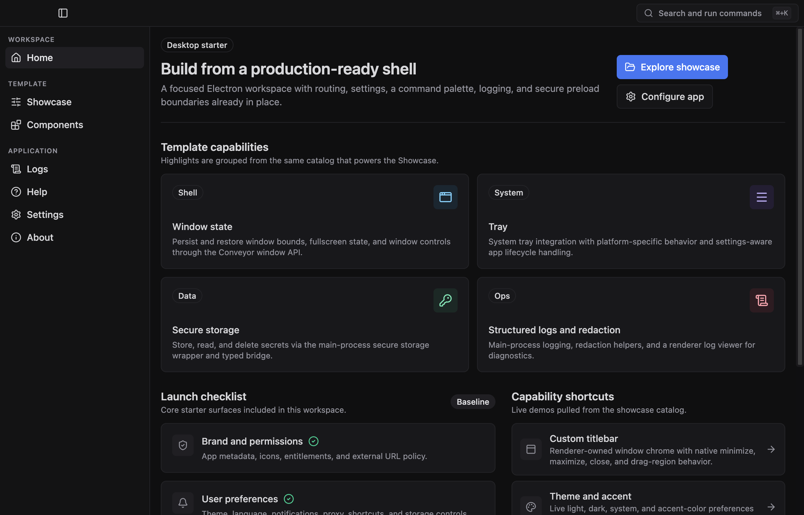
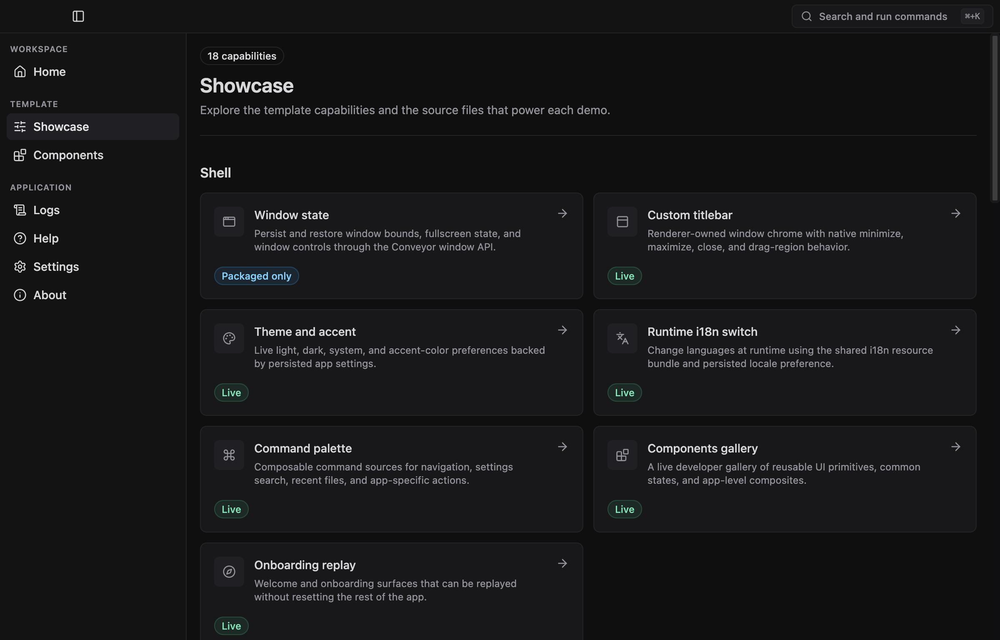
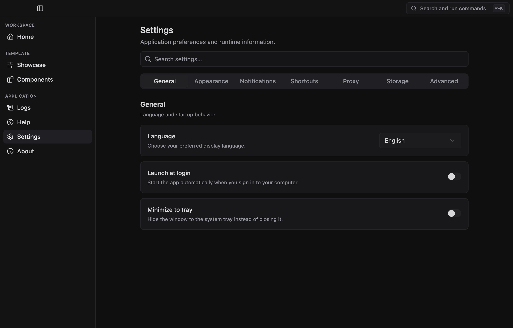

# Electron Starter

An open-source Electron + React desktop app starter that already feels like a finished app: type-safe IPC, a system
tray, deep links, a searchable settings center, a command palette, onboarding, theming, and i18n. Clone it, run it, and
replace the demo pages with your product.

> Built on [guasam/electron-react-app](https://github.com/guasam/electron-react-app) (MIT). Electron Starter keeps its
> shell and the Conveyor IPC layer, and adds the desktop platform services, app shell, settings, security hardening,
> Showcase, and tests described below. See [CREDITS.md](CREDITS.md).

[](https://github.com/soarstarter/electron-starter/actions/workflows/ci.yml)
[](LICENSE)


<p align="center">
  
</p>

It runs fully locally: no account, no backend, no `.env` file, and the app itself sends no network requests.

<table>
  <tr>
    <td></td>
    <td></td>
  </tr>
  <tr>
    <td align="center">Showcase capability catalog</td>
    <td align="center">Settings center with search</td>
  </tr>
</table>

## Features

**Desktop platform**

- Single-instance lock with app intents: a second launch, a `--route=` flag, or a deep link focuses the running window
  and navigates it.
- `electron-starter://` deep links, validated against a fixed route list.
- System tray with light, dark, and macOS template icons that follow the OS theme.
- Native application menu, localized and rebuilt when the language changes.
- Window size, position, and zoom level persisted across launches.
- Native notifications that respect the user's setting.
- Shortcut registry for menu, in-window, and global shortcuts, with per-user overrides checked at startup.
- File dialogs with a recent-files list.

**Type-safe IPC (Conveyor)**

- Every channel is declared once as a Zod schema; arguments and return values are validated in the main process.
- Typed `window.conveyor.*` APIs and a `useConveyor()` hook in the renderer. No codegen.

**Security**

- Sandboxed renderer with context isolation and a minimal preload bridge.
- Navigation guard and an external-URL policy that only opens `https:` and `mailto:` links.
- Deny-by-default permission handler, and a CSP that allows no external origins.
- Log redaction for tokens, secrets, and sensitive query parameters.
- `safeStorage`-backed secure storage for secrets.

**App shell**

- Collapsible sidebar layout, lazy-loaded routes, and a themed error fallback.
- Settings center with tabs and search: general, appearance, notifications, shortcuts, proxy, storage, and advanced.
- Command palette (`Cmd/Ctrl+K`) over routes, settings, Showcase demos, and recent files.
- First-run onboarding with an optional EULA gate.
- Light, dark, and system themes with accent colors.
- English and Chinese, switchable at runtime in both processes.
- About (with copyable, redacted diagnostics), Logs, Help, and offline banner.

**Data on the device**

- Versioned settings store with forward migrations.
- Settings backup export and import that never includes secrets.

**Showcase**

- A capability catalog with live demos for the features above, plus a gallery of the bundled shadcn/ui components.
- Everything demo-only is marked `[template-demo]` and can be removed with [docs/CUSTOMIZE.md](docs/CUSTOMIZE.md).

**Quality**

- Vitest unit tests for the main process, IPC schemas, settings, and renderer.
- ESLint, Prettier, and `tsc` in a CI workflow that also builds the app.

## Quick start

Requires Node.js `^20.19.0 || >=22.12.0` and pnpm 11.

```bash
git clone https://github.com/soarstarter/electron-starter.git
cd electron-starter
pnpm install && pnpm dev
```

No configuration is needed. [`.env.example`](.env.example) lists the two optional settings: the Showcase switch and the
repository URL used by the Help page.

## Lite and Pro

This repository is the free, MIT-licensed edition. Everything that needs a backend or a release pipeline lives in
[SoarStarter Pro](https://soarstarter.com/electron?utm_source=github&utm_campaign=electron-lite).

|                                                                            | Electron Starter (this repo) | SoarStarter Pro |
| -------------------------------------------------------------------------- | :--------------------------: | :-------------: |
| Desktop platform: tray, deep links, menus, window state, notifications     |              ✅              |       ✅        |
| Type-safe IPC with Zod validation                                          |              ✅              |       ✅        |
| Security hardening                                                         |              ✅              |       ✅        |
| Settings center, command palette, onboarding, theming, i18n                |              ✅              |       ✅        |
| Showcase and components gallery                                            |              ✅              |       ✅        |
| Unsigned local builds for Windows, macOS, and Linux                        |              ✅              |       ✅        |
| Email sign-in, profiles, and avatars (Supabase)                            |                              |       ✅        |
| GitHub and Google sign-in through the system browser                       |                              |       ✅        |
| Unified backend that shares accounts and data with the SoarStarter web app |                              |       ✅        |
| Checkout, subscriptions, license keys, and feature gates (Creem)           |                              |       ✅        |
| Auto-updates from a self-hosted update feed                                |                              |       ✅        |
| Code signing, notarization, and a tagged release workflow                  |                              |       ✅        |
| Opt-in error reporting (Sentry) and product analytics slots                |                              |       ✅        |
| Playwright smoke tests and a one-command rebrand script                    |                              |       ✅        |

## Scripts

| Command                                                  | What it does                                          |
| -------------------------------------------------------- | ----------------------------------------------------- |
| `pnpm dev`                                               | Start Electron and Vite with hot reload               |
| `pnpm start`                                             | Preview the built app                                 |
| `pnpm lint:check` / `pnpm lint`                          | Lint (`lint` also fixes)                              |
| `pnpm format:check` / `pnpm format`                      | Check or apply Prettier formatting                    |
| `pnpm typecheck`                                         | Type-check the main, preload, and renderer projects   |
| `pnpm test` / `pnpm test:unit`                           | Run the core unit tests / all unit tests (as CI does) |
| `pnpm build:unpack`                                      | Build an unpacked app into `dist/`                    |
| `pnpm build:mac` / `pnpm build:win` / `pnpm build:linux` | Build unsigned installers for one platform            |

Builds target an NSIS installer on Windows (x64), a DMG on macOS 13 or later, and AppImage, Snap, and deb packages on
Linux (x64). They are not signed, so macOS Gatekeeper and Windows SmartScreen will warn when you open them on another
machine.

## Project structure

```text
app/                 Renderer: React routes, components, hooks, locales, styles
  showcase/          [template-demo] capability catalog
  routes/showcase/   [template-demo] Showcase pages, demos, and components gallery
lib/main/            Main process: window, tray, menu, intents, settings, logging, security
lib/conveyor/        Typed IPC: schemas/ (Zod), api/ (renderer side), handlers/ (main side)
lib/preload/         Preload bridge exposed with context isolation
shared/              Code used by every process: brand constants and config flags
resources/build/     App and tray icons, macOS entitlements
```

Path aliases: `@/app`, `@/lib`, `@/shared`, and `@/resources`.

## Type-safe IPC in four steps

1. Declare the channel in a schema file under `lib/conveyor/schemas/`:

   ```ts
   export const greetIpcSchema = {
     'greet-user': { args: z.tuple([z.string().min(1)]), return: z.string() },
   }
   ```

2. Register it in `ipcSchemas` (`lib/conveyor/schemas/index.ts`).
3. Implement it in the main process with `handle('greet-user', (_event, name) => \`Hello, ${name}\`)`, which validates
   the arguments and the return value against the schema.
4. Expose it from an API class in `lib/conveyor/api/`, add that class to the `conveyor` object in
   `lib/conveyor/api/index.ts`, and call it from React:

   ```tsx
   const { greetUser } = useConveyor('greet')
   const message = await greetUser('Ada')
   ```

## Deep links

Once the app is installed, the OS opens it at a route:

```bash
open 'electron-starter://settings'      # macOS
xdg-open 'electron-starter://settings'  # Linux
start electron-starter://settings       # Windows
```

Routes are limited to the `navigationRouteSchema` list in `lib/conveyor/schemas/event-schema.ts`; anything else is
ignored.

## Make it yours

- Brand: edit `shared/constants.ts`, then the matching fields in `electron-builder.yml` and `package.json`, and replace
  the icons in `resources/build/`. The full list is in [docs/CUSTOMIZE.md](docs/CUSTOMIZE.md).
- Showcase: set `VITE_SHOWCASE_ENABLED=false` and `MAIN_VITE_SHOWCASE_ENABLED=false` to preview the app without it, then
  follow [docs/CUSTOMIZE.md](docs/CUSTOMIZE.md) to delete it.
- Guides for each part of the template:
  [soarstarter.com/docs/electron](https://soarstarter.com/docs/electron?utm_source=github&utm_campaign=electron-lite).
  Pages marked Pro cover features that are not in this repository.

## Contributing and security

Bug fixes and small improvements are welcome; see [CONTRIBUTING.md](CONTRIBUTING.md). To report a vulnerability, follow
[SECURITY.md](SECURITY.md) instead of opening a public issue.

## Credits and license

Electron Starter started from [electron-react-app](https://github.com/guasam/electron-react-app) by
[guasam](https://github.com/guasam). Thanks to that project and to the libraries listed in [CREDITS.md](CREDITS.md).

Released under the [MIT License](LICENSE).
